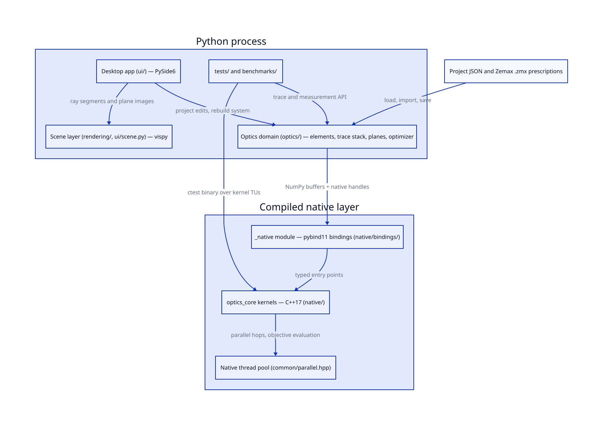
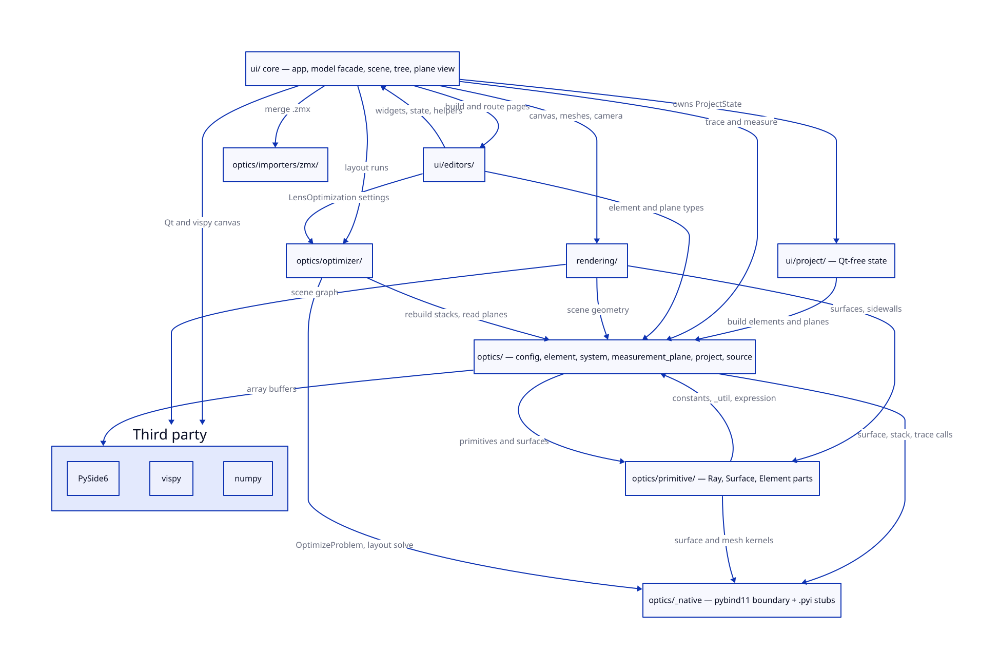
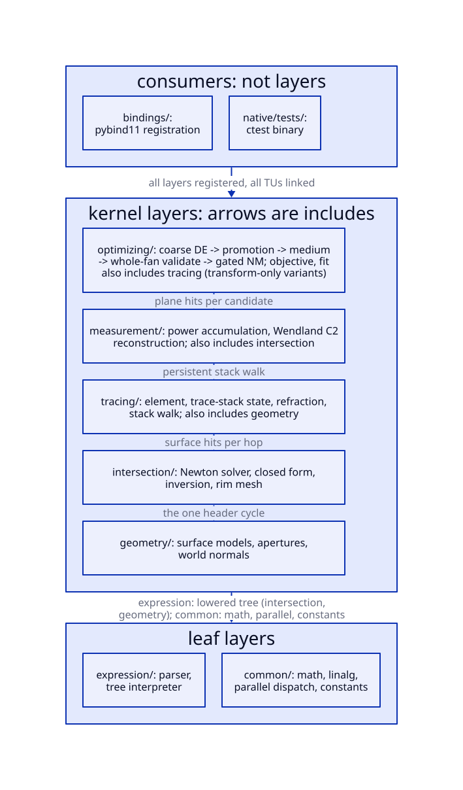
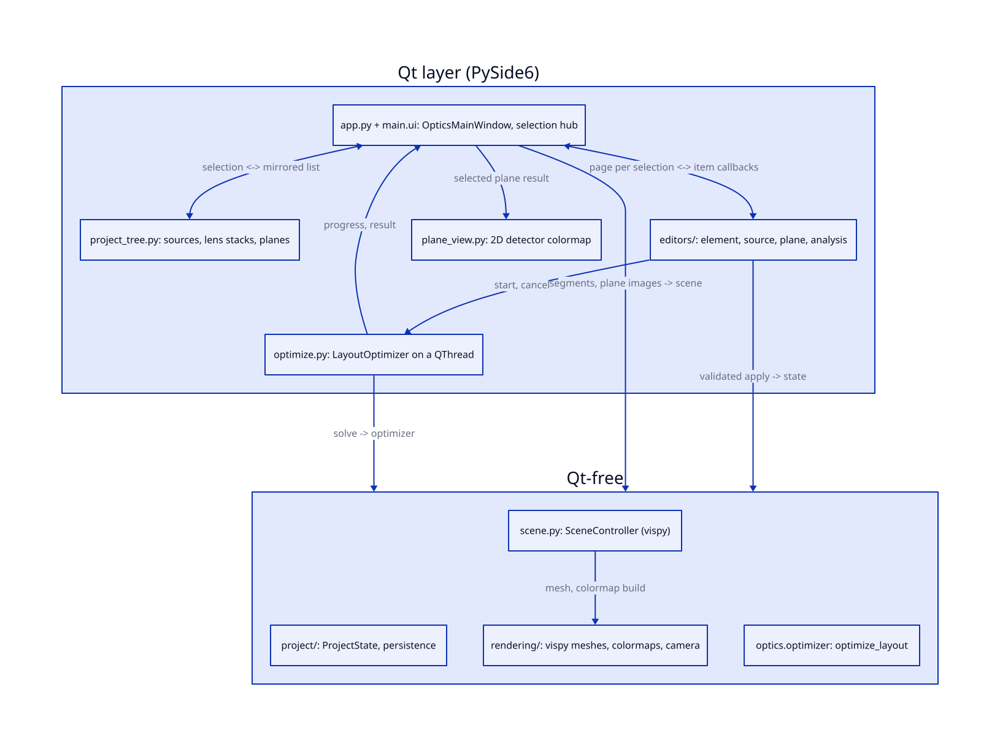
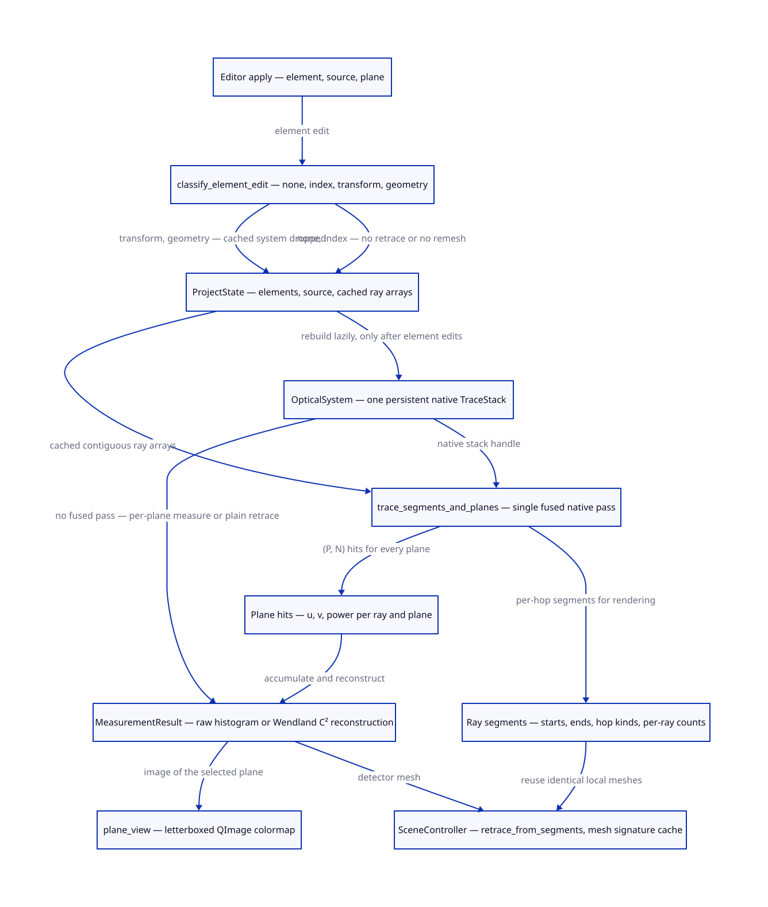
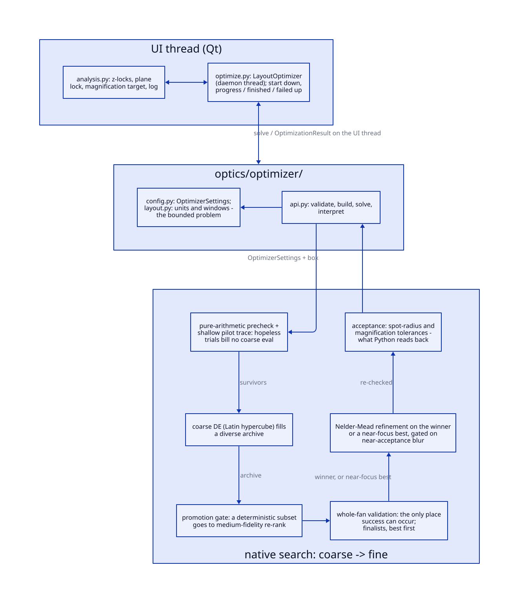
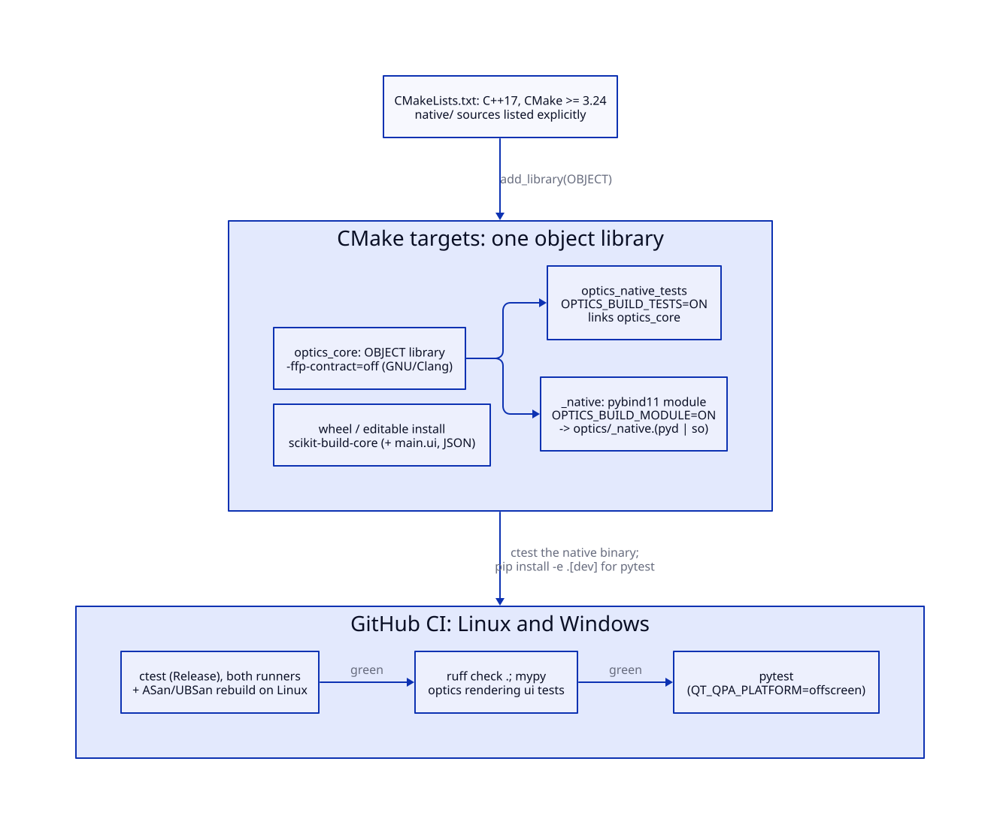

## Architecture

Hot numerics (expression evaluation, Newton solvers, intersection, stack
tracing, measurement) run in a compiled C++ kernel library exposed to Python as
`optics._native` (stubs in `optics/_native.pyi`); NumPy carries array buffers
only.

### Block diagrams

[D2](https://d2lang.com) sources live under `./diagrams/`; re-render after
editing one:

```sh
d2 diagrams/native-modules.d2 diagrams/native-modules.svg
```

**1. Layers and the Python/native boundary.** The domain layer sends contiguous
NumPy buffers and opaque native handles across pybind11 and receives arrays
back: per-ray work never enters the interpreter.



**2. Python package dependencies.** Edges are real imports. The single cycle is
intentional and thin: `optics/primitive/` uses the support modules (`constants`,
`_util`, `expression`) while the core packages above build on the primitives.
Neither `ui/` nor `rendering/` reaches past `optics/` into `_native`: only
`benchmarks/` and a few kernel-level tests do. Arrows between bands are drawn
once per band and name the boxes they leave and the packages they reach;
`optics/_native` and the third-party band are leaves.



**3. Native module layering.** Includes, not declarations: each arrow means
`A/#include <optics/B/...>`. `expression/` and `common/` are leaves;
`geometry/` <-> `intersection/` is the one header cycle (`geometry/surface.hpp`
reuses the plane and rim-mesh primitives). `native/tests/` links the whole
library, so it is a consumer, not a layer. Consumer and leaf arrows are drawn
once per band; `bindings/` also reaches `expression/` (`parse`) and `common/`
(`rotation_from_z`) directly.



**4. Desktop application blocks.** Only the Qt container's boxes touch PySide6.
`ProjectState` and the vispy `SceneController` are Qt-free, so the document
model and scene bookkeeping unit-test headless (CI: `QT_QPA_PLATFORM=offscreen`).
The window learns of list changes from the `on_items_changed` callbacks it hands
the tree and editors, not from the state object. `main.ui` sits inside the
window box; arrows into the Qt-free band start at the box that talks to it.



**5. One UI refresh.** One native walk serves everything: ray segments for the
3D view, `(u, v, power)` hits for every measurement plane. Downstream work
(meshes, detector images, the 2D view) is derived and cached by geometry
signature, so unchanged lenses are neither remeshed nor retraced.



**6. Layout optimization.** The search runs entirely in native code over
transform-only stack variants; Python builds the bounded problem and reads the
outcome, so the UI thread never enters the objective.



**7. Build and test pipeline.** One object library feeds shipped and tested
artifacts alike: the kernels the native tests exercise are the kernels the wheel
ships. CI builds Release on both runners, rebuilds the native test binary under
ASan/UBSan on Linux, and runs `pytest` only after `ruff` and `mypy` pass.



### Modules

- `native/`: C++17 kernels, built as `optics_core` (object library) and
  `_native` (pybind11 module, bindings in `native/bindings/`). Layered
  `common <- expression <- geometry <- intersection <- tracing <- measurement <-
  optimizing`; headers `include/optics/<module>/`, sources per module:
  - `expression/`: parses and validates the restricted surface-expression
    grammar; interprets the lowered tree
  - `geometry/`: surface models and descriptors - expression evaluation,
    finite-difference tangents, aperture membership, world-space normals
  - `intersection/`: ray/surface intersection - seed-grid accelerated
    damped-Newton for generic surfaces; construction-time classified closed-form
    (plane/conic) and guarded 1D (asphere) sag-graph solvers with analytic
    normals; parameter inversion, rim meshing, plane/mesh primitives
  - `tracing/`: persistent element/trace-stack state, refraction/total internal
    reflection, element/stack walk, shared single-trace hop recording
  - `measurement/`: plane power accumulation, adaptive-kernel (Wendland C2)
    irradiance reconstruction, direct/stacked plane measurement, fused
    trace+planes batch pass
  - `optimizing/`: best-focus layout solver - Latin-hypercube-initialized
    bounded differential evolution, gated Nelder-Mead polish, over transform-only
    stack variants; focus measure: pooled per-object-point spot-radius fit
  - `common/`: vector/matrix math, small-system linalg (`rotation_from_z`),
    parallel dispatch (native threading), `constants.hpp`; `-ffp-contract=off`
    keeps floating-point evaluation order faithful to strict IEEE semantics
  - `tests/`: native unit test TUs, one ctest binary (see Testing)
- `optics/`: numerics core, no GUI/OpenGL dependencies:
  - `primitive/`: geometric primitives - `ray.py`, `transform.py`, `hit.py`,
    `material.py`, `aperture.py`, `sidewall.py` (lens rims intersected by the
    native Moller-Trumbore mesh kernel), `vector.py` (native vector helpers),
    `surface.py` (parametric surfaces delegating every numerical operation to
    the persistent native surface)
  - `expression.py`: restricted, safe surface-expression grammar enforced by the
    native parser; expression strings -> native surface model via
    `_native.compile_surface`, lru-cached
  - `element.py`: `RefractiveElement` (cached sidewall construction, one
    persistent native element for its lifetime)
  - `system.py`: `OpticalSystem`, the only public tracing entry point -
    immutable element stack owning one persistent native trace stack; batched
    parallel tracing, measurement, fused segments+planes pass
  - `measurement_plane.py`: planar detector accumulating ray power (native
    accumulation, adaptive-kernel reconstruction)
  - `plane_transform.py`: best 2D similarity (magnification, rotation, offset)
    fitted to the per-ray hit correspondence between two planes
  - `constants.py`: numerical tolerances, solver defaults
  - `source.py`: point sources, ray emission
  - `config.py`: JSON -> element/stack loading
  - `io.py`: JSON project-document loading (Zemax `.zmx` is import-only)
  - `project.py`: versioned project documents (elements + source + measurement
    planes)
  - `optimizer.py`: `optimize_layout`, best-focus optimization of the free
    elements' z and the image plane (native DE + gated Nelder-Mead,
    focus-acceptance contract on the returned layout)
  - `importers/zmx.py`: Zemax `.zmx` prescription parser -> element configs and
    geometry, merged into an open project (never a project loader)
  - `examples/`: bundled example stacks (`doublet.json`, `triplet.json`)
- `rendering/`: vispy meshing (`meshing.py`, geometry-signature cache: identical
  local meshes are reused across edits), shared viridis colormap LUT and
  normalization for the detector meshes and 2D plane view (`colormaps.py`),
  scene building (`visualize.py`), standalone demo (`demo.py`)
- `ui/`: PySide6 desktop application (`main.ui` is the Qt Designer layout):
  - `app.py`: composition root - `OpticsMainWindow`, project load/save, Zemax
    import merge, menu dialogs, `make_display`/`main` entry points; runs the
    unified refresh
  - `model.py`: Qt-free `ProjectState` (element/source/plane state including
    planes locked to the source, unified naming, edit classification for the
    fast lens-edit path, document load/save via `optics.project`)
  - `scene.py`: `SceneController` - vispy view and node bookkeeping for
    elements, rays, the source marker, measurement planes, selection highlight
    (tinted lenses, rim-tinted plane)
  - `editors.py`: `ElementEditor`/`SourceEditor`/`PlaneEditor`/`SubmoduleEditor`
    controllers over the dock widgets (populate/apply/add/remove);
    `AnalysisEditor` drives the Optimize Layout panel (element z-lock table,
    image-plane lock, progress and result log)
  - `optimize.py`: `LayoutOptimizer` worker thread running `optimize_layout`,
    results marshalled back onto the UI thread
  - `plane_view.py`: 2D colormap view of a measurement plane's detector image
    (letterboxed `QImage` raster, shared viridis LUT)
  - `project_tree.py`: `ProjectTree` in the left dock - mirrors the project as
    source / lens stack / measurement planes and reports a `(kind, name)`
    selection the window routes to the matching editor page and 3D highlight
    (and back, when an editor changes selection itself). Lenses group into
    *submodules* (nested category under Elements): drag a lens onto a submodule
    node, onto another lens (adopt its group) or onto Elements (ungroup); the
    Elements group context menu creates, renames and removes them. The
    `submodule` key on member configs persists this in the project JSON and
    never retraces. A
    submodule's properties page sits at the group's first member; applying it
    translates all members by the same offset, so spacing holds and the trace
    re-runs
  - `widgets.py`: shared PySide6 helpers (`find_child`, `configure_spin`,
    `enable_widgets`, `run_validated`)
